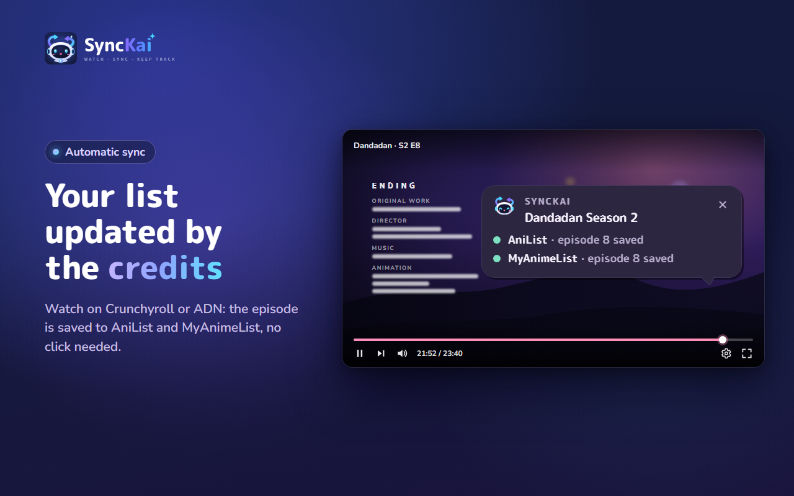
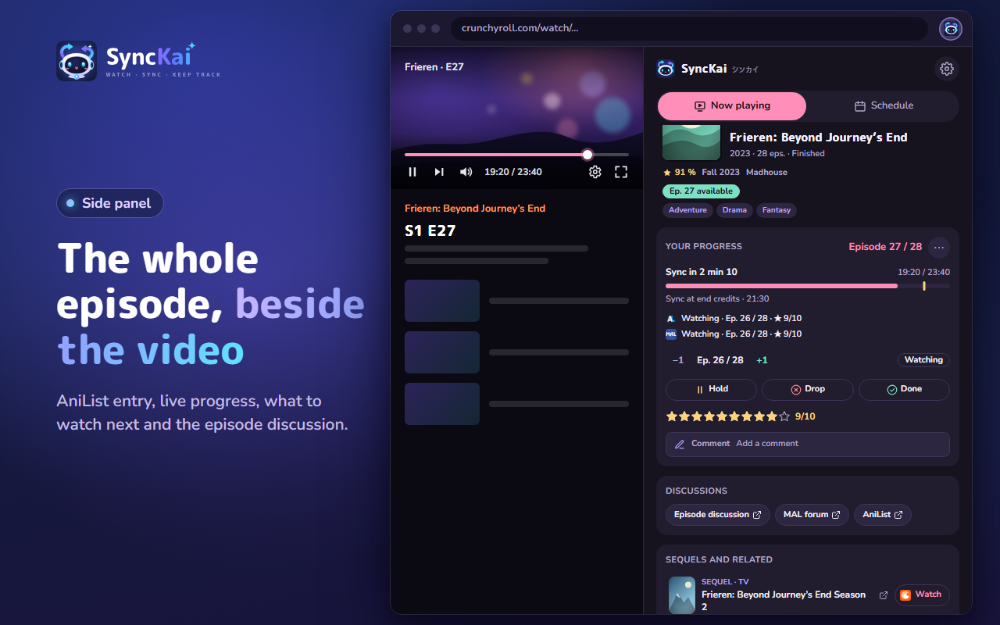
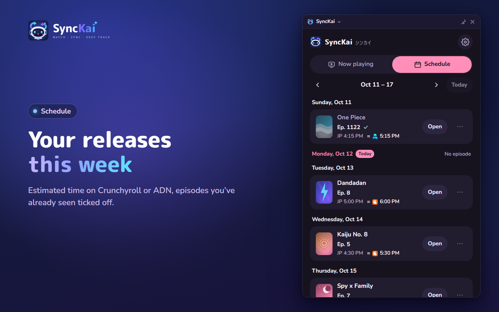
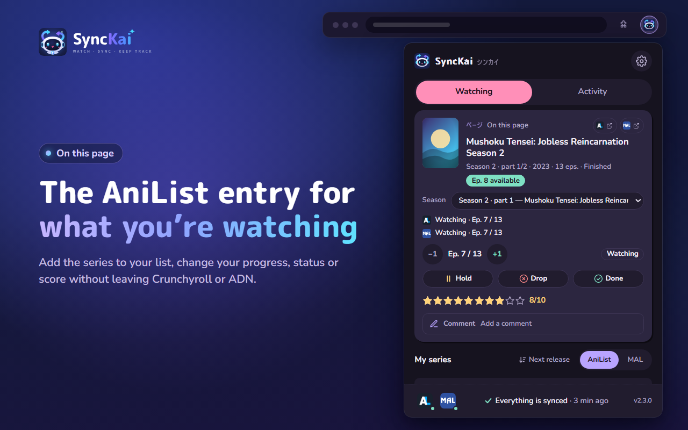
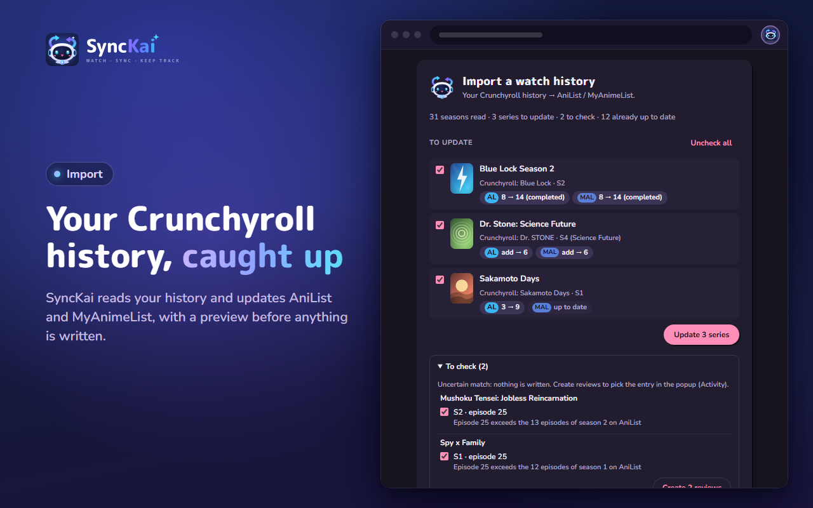

<p align="center">
  <picture>
    <source media="(prefers-color-scheme: dark)" srcset="assets/brand/kai-lockup-dark.svg">
    
  </picture>
</p>

<p align="center"><strong>Watch anime on Crunchyroll or ADN. Your AniList and MyAnimeList lists update themselves when the credits roll.</strong></p>

<p align="center">
  <a href="https://github.com/Sync-Kai/SyncKai/releases/latest"></a>
  <a href="https://chromewebstore.google.com/detail/synckai/khokcmigioggannjoojambdgioigdceb"></a>
  <a href="https://addons.mozilla.org/firefox/addon/synckai/"></a>
  <a href="https://github.com/Sync-Kai/SyncKai/actions/workflows/ci.yml"></a>
  <a href="LICENSE"></a>
</p>

<p align="center">
  
</p>

**SyncKai** is a browser extension for Chrome and Firefox that keeps your anime list up to date without any manual input. Start an episode on Crunchyroll, ADN or (optionally) Netflix and Disney+: SyncKai recognizes the series, finds the right entry, and saves your progress to AniList and/or MyAnimeList as soon as the ending credits start. It runs entirely in your browser, with no account of its own and no server.

## Contents

- [Install](#install)
- [Features](#features)
- [Supported platforms and trackers](#supported-platforms-and-trackers)
- [How it works](#how-it-works)
- [Privacy](#privacy)
- [Development](#development)
- [Contributing](#contributing)
- [License](#license)

## Install

| Browser | Store | Minimum version |
| --- | --- | --- |
| Chrome | [Chrome Web Store](https://chromewebstore.google.com/detail/synckai/khokcmigioggannjoojambdgioigdceb) | Chrome 116 |
| Firefox (desktop) | [Firefox Add-ons](https://addons.mozilla.org/firefox/addon/synckai/) | Firefox 142 |

Other Chromium-based browsers (Edge, Brave, Opera…) install SyncKai from the Chrome Web Store. Chrome is the primary test target.

Then click the SyncKai icon, connect AniList and/or MyAnimeList (each account is optional), and watch an episode as usual.

> [!NOTE]
> AniList and MyAnimeList sign-in is only allowed for the official extension IDs. Store installs and local builds of this repository work. The Chrome zip attached to a GitHub release has no `key`: loaded by hand, it gets a different ID and cannot sign in.

## Features

**Sync**

- Automatic sync at the start of the credits (Crunchyroll, Netflix), or at an adjustable percentage of the episode (70–98%, 85% by default).
- AniList and MyAnimeList, together or separately.
- Season matching that handles absolute numbering (One Piece episode 1180) as well as seasons split across several entries.
- *To check* cards: when a match is uncertain, you pick the right entry once and SyncKai remembers it. Nothing is sent blindly.
- Netflix support, off by default and limited to anime: only series linked to their Netflix title on AniList are synced.
- Disney+ support, off by default and limited to Japanese anime: only series whose AniList entry carries the same title and a Disney+ link are synced.

**Your lists**

- *Watching*: series in progress with the next episode's date ("Ep. 5 in 18 h"), sorting, +1 / −1, and *Open* on your preferred player.
- *On this page*: the AniList entry of the series or episode you are on, with editable progress, status and score.
- One-click status changes (on hold, dropped, completed) on both services; remove an anime from your list or edit its comment, from the popup or the side panel.
- Remove a series from your list (confirmed first) and write a comment on its entry (AniList notes, MyAnimeList comments), from the ⋯ menu of *Watching* or the *Your progress* card of the side panel.
- Click a title or cover to open its AniList or MyAnimeList page (*Default entry page* setting when both accounts are connected).
- Compare AniList and MyAnimeList: spots differences in progress, status, score and missing series, and aligns them on demand, never automatically.
- Rating prompt when a series is completed, and rewatch detection.

**Side panel and schedule**

- Side panel (sidebar on Firefox) available on any page, opened only by you: from the popup or with <kbd>Alt</kbd>+<kbd>Shift</kbd>+<kbd>1</kbd> (press again to close). On Chrome and Brave it stays open across tabs and follows the active tab.
- Off the streaming sites it opens on *Schedule*; *Now playing* shows the supported platforms and turns Netflix or Disney+ on in one click.
- *Now playing* (Crunchyroll, ADN, Netflix, Disney+): the episode's AniList entry, live progress ("Sync in 2 min 10"), your actions, sequels with a *Watch* button, and the episode discussion.
- *Schedule*: this week's releases for the series you're watching, with the estimated time on each platform (adjustable delay, per series if needed) and watched episodes ticked off.
- New episode alerts as browser notifications, with an adjustable delay.

**Import and backup**

- Crunchyroll, ADN and Netflix history import: reads your history in your own browser tab, shows a preview, then updates AniList and MyAnimeList in the background. It never moves progress backwards, only counts finished episodes, and asks for a review when in doubt. On Netflix, it loads the *Viewing activity* page with the site's own *Show more* button and keeps only anime (series linked to Netflix on AniList, or with the same title, which go to *To check*).
- Backup: export and import your settings, matches and history (never your sign-ins).

**Privacy and reliability**

- No server, no analytics: data only goes to AniList and MyAnimeList.
- Offline queue: if the network or a service is down, pending syncs are retried automatically.
- On-page notifications in three levels (Discreet, Detailed, Alerts only), fullscreen-friendly.
- Keyboard shortcuts, the same on Chrome, Brave and Firefox: <kbd>Alt</kbd>+<kbd>Shift</kbd>+<kbd>K</kbd> to mark the current episode as watched, <kbd>Alt</kbd>+<kbd>Shift</kbd>+<kbd>1</kbd> to open or close the side panel (<kbd>Alt</kbd>+<kbd>Shift</kbd>+<kbd>&</kbd> on AZERTY: same key). *Settings › Shortcuts* shows the current keys and opens the browser's shortcuts page to change them (`chrome://extensions/shortcuts`; Firefox: `about:addons` › gear icon › *Manage Extension Shortcuts*). Already installed? A key you changed is kept on update; if a key is missing, set it there.
- Per-series exclusion, settings grouped by category with quick toggles.
- Interface in English, French and German.

<table>
  <tr>
    <td></td>
    <td></td>
  </tr>
  <tr>
    <td></td>
    <td></td>
  </tr>
</table>

## Supported platforms and trackers

| Streaming platform | End of episode detected at | Notes |
| --- | --- | --- |
| [Crunchyroll](https://www.crunchyroll.com) | Start of the credits (percentage fallback) | History import available |
| [ADN](https://animationdigitalnetwork.com) | Adjustable percentage | History import available |
| [Netflix](https://www.netflix.com) | Start of the credits (percentage fallback) | Optional, anime only; history import available |
| [Disney+](https://www.disneyplus.com) | Adjustable percentage | Optional, Japanese anime only |

| Tracker | Sign-in |
| --- | --- |
| [AniList](https://anilist.co) | OAuth2 (implicit grant) |
| [MyAnimeList](https://myanimelist.net) | OAuth2 with PKCE, no client secret |

**Netflix** is off by default. Turn it on in *Settings › Playback & sync*: the browser then asks for access to netflix.com, and turning it off removes that access. Since Netflix does not label anime, only series whose AniList entry links to the Netflix title are synced. A series found by title alone goes through a *To check* card, and other titles are silently ignored.

**Disney+** is off by default too (*Settings › Playback & sync*, access to disneyplus.com). Only titles whose original language is Japanese are considered; the others are ignored in the page without being sent anywhere. Disney+ gives no series ID on its player page, so the English series title (season 99 arcs by their own title) is matched against AniList, and a match is trusted only if that entry links to Disney+; otherwise it goes through *To check*. SyncKai sends no request to Disney+: it reads the response the player already receives, and the position from the player's progress bar. In a Disney+ tab opened before turning it on (or before an update), tracking starts with the next episode.

## How it works

1. A content script, with one adapter per platform (`src/content/adapters/`), reads the series, season and episode number from the playback page and watches the video position.
2. The service worker matches the episode to an AniList entry, mapping platform seasons to AniList entries and converting per-season or absolute numbering. The MyAnimeList entry is resolved from the AniList one.
3. When the credits start (or the threshold is reached), the new progress is written to each connected service. It never goes backwards, and failed writes wait in a retry queue.
4. If the match is uncertain, nothing is written: a *To check* card lets you choose the entry, and the choice is remembered.

## Privacy

SyncKai has no server and collects no usage data.

- Settings, matches and history stay in the extension's local storage.
- OAuth tokens are stored encrypted (AES-GCM, non-exportable key) and only sent back to the service that issued them.
- The extension only contacts AniList, MyAnimeList and the streaming sites you use (Crunchyroll credit markers, your Crunchyroll, ADN or Netflix history when you start an import, Netflix episode metadata when Netflix is turned on). On Disney+, nothing is requested: SyncKai only reads what the player already receives.

Permissions: `storage`, `identity` (sign-in), `alarms` (release alerts, retries), `notifications`, `sidePanel`, `scripting`, host access to Crunchyroll, ADN, AniList and MyAnimeList, and optional access to Netflix and Disney+.

Full details in [PRIVACY.md](PRIVACY.md).

## Development

**Requirements**: Node.js 24 (see [`.nvmrc`](.nvmrc)) and npm 11.

```sh
npm ci                  # install dependencies
npm run dev             # development build with hot reload (Vite + @crxjs/vite-plugin)
npm run build           # production build for Chrome, in dist/
npm run build:firefox   # production build for Firefox, in dist-firefox/
npm run build:dev       # Chrome build with info/debug logs in the console
npm test                # unit tests (Vitest)
npm run test:e2e        # popup end-to-end tests (Puppeteer, headless Chrome)
npm run verify          # type check, tests, both builds, build checks and lint
```

`npm ci` downloads a headless Chrome for the end-to-end tests. To skip it, see [BUILD.md](BUILD.md). If `npm run test:e2e` cannot find a browser, run `npx puppeteer browsers install chrome-headless-shell`.

**Load the extension**

- Chrome: open `chrome://extensions`, enable *Developer mode*, click *Load unpacked* and select `dist/`.
- Firefox: open `about:debugging#/runtime/this-firefox`, click *Load Temporary Add-on* and select `dist-firefox/manifest.json`.

The repository manifest keeps the Chrome Web Store public key and the Firefox add-on ID, so local builds get the official extension IDs and can sign in to AniList and MyAnimeList. After reloading the extension, reopen the player tab.

**Project structure**

```
src/
├── background/   service worker: OAuth, AniList/MAL API, matching, sync queue, alerts
├── content/      content scripts: one adapter per platform (adapters/), Netflix and Disney+ page bridges (netflix/, disney/)
├── popup/        extension popup
├── sidepanel/    side panel (Now playing, Schedule)
├── import-cr/    history import page (Crunchyroll, ADN, Netflix)
├── import/       backup page
├── ui/           UI components shared by the popup and the side panel
├── shared/       types, storage, settings and logic shared by all contexts
└── i18n/         translations (locales/en.json, fr.json, de.json)
```

Store names and descriptions live in `public/_locales/`.

- [BUILD.md](BUILD.md): reproducible build of the Firefox package.
- [docs/STORE.md](docs/STORE.md): packaging and release process (Chrome Web Store, Firefox Add-ons, GitHub Actions).
- [CHANGELOG.md](CHANGELOG.md): release history.

## Contributing

Bug reports and suggestions are welcome in [GitHub Issues](https://github.com/Sync-Kai/SyncKai/issues). When reporting a bug, attach the diagnostic report (*Settings › Help & about › Copy diagnostic report*). It contains no sensitive data.

Pull requests are welcome too, including translations (`src/i18n/locales/`). Please run `npm run verify` before opening one.

## License

[MIT](LICENSE) © 2026 Quentin Geerts

SyncKai is not affiliated with Crunchyroll, ADN, Netflix, Disney+, AniList or MyAnimeList.
